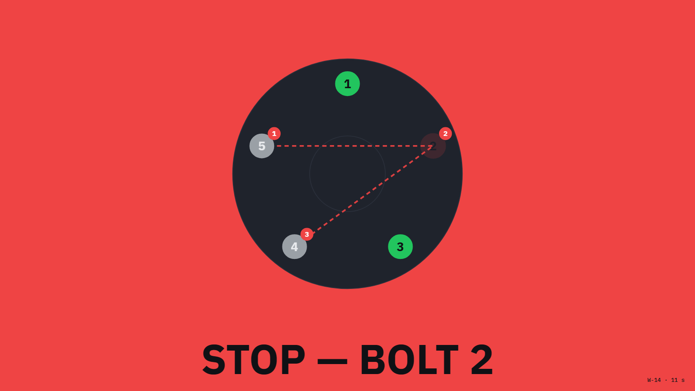
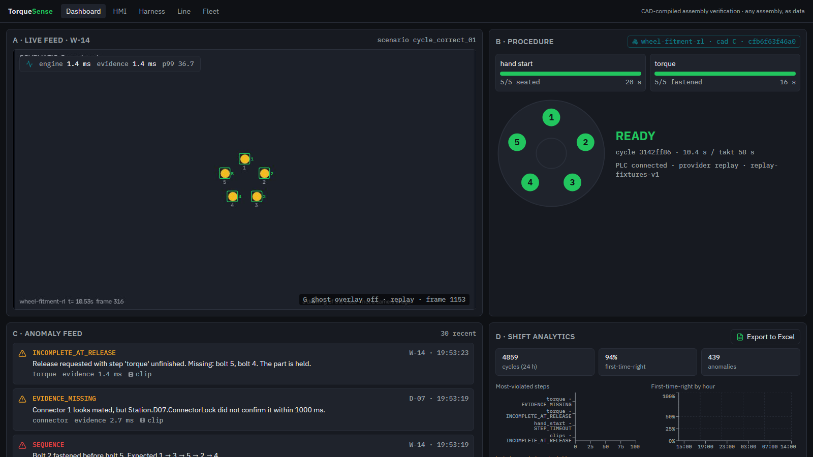
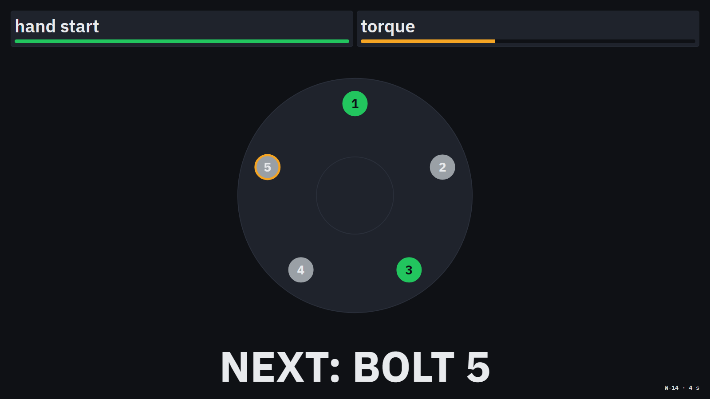
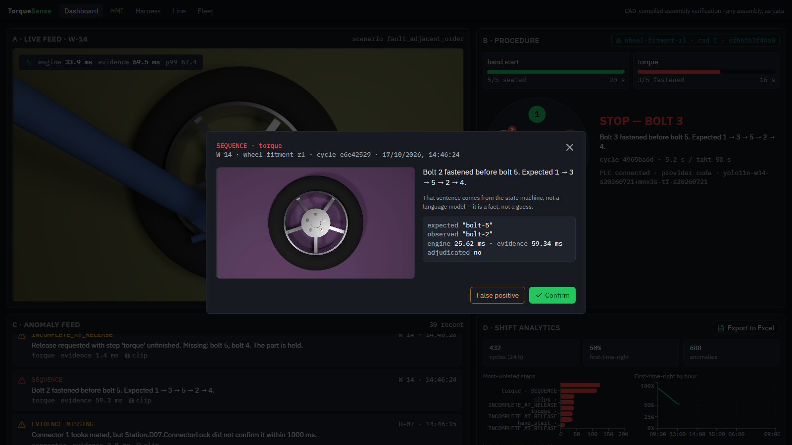
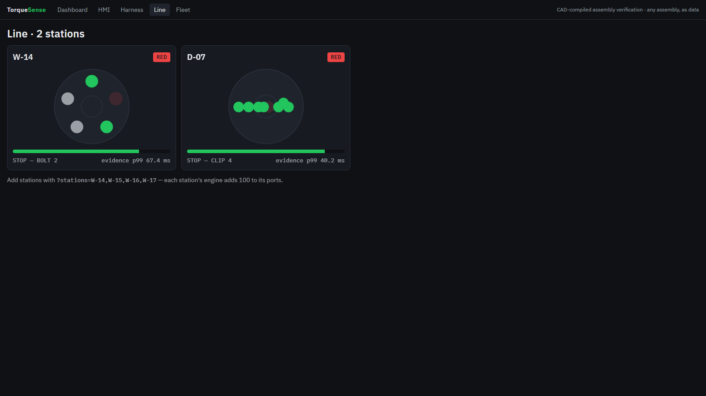

# TorqueSense

**Real-time assembly verification from a camera.** TorqueSense watches a workstation, checks that every
step of an assembly happens in the right order, and stops the line within a fraction of a second when a
step is skipped or done out of order. The procedure is compiled from the product's CAD model, not
hand-written.

[](https://github.com/Gurjas2112/TorqueSense/actions/workflows/ci.yml)
&nbsp; **Live demo:** https://dist-replay-one.vercel.app &nbsp;·&nbsp;
**Video walkthrough:** [app_screenshots_screen_recording/](app_screenshots_screen_recording/README.md)



---

## At a glance

| | |
|---|---|
| **What it does** | Turns a camera feed into a live, step-by-step check of a manual assembly and raises a physical alarm (an industrial PLC signal) the moment something goes wrong |
| **Why it matters** | The costliest assembly mistakes look correct afterwards: a bolt tightened out of sequence, a clip left open under a panel. Inspecting the finished product is too late |
| **How it works** | CAD model → compiled procedure → a vision model reads each inspection point → a deterministic state machine decides → an alarm goes to the PLC |
| **Headline result** | A wrong step is detected and signalled in **63 ms at the 99th percentile**, against a 1-second requirement, at 30 frames/s with no dropped frames (100-cycle test) |
| **Any product** | Each assembly is a folder of data. The same engine binary checks a wheel, a door-trim harness, a windshield gasket, an electronics enclosure and earbuds going into a charging case |
| **Stack** | C++20 · Python (FastAPI, PyTorch) · ONNX Runtime (CUDA, TensorRT) · React 19 + TypeScript · Go · OPC-UA · Postgres (Supabase) · Docker · GitHub Actions and Jenkins |

## Contents

1. [The problem and the idea](#1-the-problem-and-the-idea)
2. [See it working](#2-see-it-working)
3. [Results](#3-results)
4. [Features](#4-features)
5. [Architecture](#5-architecture)
6. [Getting started: pick your path](#6-getting-started-pick-your-path)
7. [Using it](#7-using-it)
8. [Add your own assembly](#8-add-your-own-assembly)
9. [From CAD to a trained model](#9-from-cad-to-a-trained-model)
10. [Testing and CI](#10-testing-and-ci)
11. [Project structure](#11-project-structure)
12. [Engineering principles](#12-engineering-principles)
13. [Limitations and roadmap](#13-limitations-and-roadmap)
14. [Security](#14-security)

---

## 1. The problem and the idea

On an assembly line, a wheel's five bolts must be tightened in a star pattern (1 → 3 → 5 → 2 → 4) so
the wheel seats evenly. An operator who is interrupted after bolts 1 and 3 might come back and carry on
"in order" from bolt 2. Nothing looks wrong, and the finished wheel passes a visual check, but the
procedure was broken.

TorqueSense checks the **procedure**, not the finished product:

1. **Compile the procedure from CAD.** A compiler reads the product's STEP file, finds every fastener
   or clip by part number, works out the required order from the geometry (the star order comes from
   the bolt positions; nobody types it in), and confirms the camera can actually see each point.
2. **Ask a closed question at each point.** The vision model never asks "what is this?". At each known
   point it asks "which of these two or three states is it in?", for example absent, seated or
   tightened. That is a much easier and more reliable task, and one classifier serves every product
   that uses the same kind of part.
3. **Let a state machine decide.** A deterministic engine turns the observed states into a verdict. It
   recognises six kinds of mistake: wrong order, a prerequisite skipped, a missing confirmation from the
   tool, a step undone, a step that took too long, and a release with work still unfinished.
4. **Alert through the PLC.** A verdict is written to the programmable logic controller over OPC-UA,
   which turns the Andon light red and requests a conveyor hold. The PLC also watches a heartbeat, so
   if the software dies, the station turns amber on its own.

## 2. See it working

| | |
|---|---|
|  |  |
| **Engineer dashboard:** live feed with the CAD points overlaid, the procedure, the anomaly feed and shift analytics | **Operator screen:** the next bolt pulses. The operator doesn't need to read anything |
|  |  |
| **Every anomaly** comes with a six-second clip, a plain-English explanation and a review button | **The line view:** a wheel station and a door-trim station run the same engine |

- **Full walkthrough:** 16 screenshots in flow order plus a 2-minute video, in
  [app_screenshots_screen_recording/](app_screenshots_screen_recording/README.md).
- **Live demo:** https://dist-replay-one.vercel.app replays a recorded session of the engine in your browser.
  Nothing to install.

## 3. Results

Measured on a consumer laptop with an NVIDIA GPU. The full logs, conditions and method are in
[docs/VALIDATION.md](docs/VALIDATION.md).

| What | Result |
|---|---|
| **Time to alarm**, from the first frame showing the mistake to the PLC confirming the write | **p99 62.8 ms** (budget 1,000 ms), 200 alerts over 100 cycles |
| Throughput while doing it | 30.00 frames/s, 0 of 45,008 frames dropped |
| Hand and tool detector (YOLO11n) on 400 unseen rendered images | mAP50 **0.994**, mAP50-95 0.958 |
| Bolt-state classifier (MobileNetV3-Small) on 2,000 unseen crops | **98.7 %** top-1 |
| Engine vs. an independent reference implementation | 0 disagreements across 22 recorded scenarios |
| Network cut for 45 s | alarms kept working; 14/14 events reached the cloud in order once the network returned |
| Software failure (camera frozen) | the PLC turned the station amber 2.4 s after the last heartbeat |
| Hot path | 0 memory allocations over 10,000 frames; no locks |

> **Read honestly:** the accuracy figures are on rendered images of the CAD model. Accuracy on real
> camera photos needs a labelled photo set, which does not exist yet (see
> [Limitations](#13-limitations-and-roadmap)).

## 4. Features

- **CAD compiler:** reads STEP files, derives bolt patterns and orders, projects points into the camera
  and ray-casts occlusion. It refuses to compile a procedure with a point the camera can't resolve.
- **Real-time C++ engine:** four pinned threads joined by lock-free ring buffers, with no allocation
  and no locks on the hot path.
- **Interchangeable perception:**
  - GPU: YOLO11n plus a per-point classifier on ONNX Runtime, using CUDA or TensorRT.
  - Schematic: reads the states straight from the pixels of schematic videos.
  - Replay: plays back recorded detector output, so the system runs on any machine.
- **Industrial I/O:** an OPC-UA soft PLC with a heartbeat watchdog, and a Node-RED tag view.
- **Evidence:** a shared-memory ring keeps the last few seconds of video, so every anomaly gets its own
  clip. A Florence-2 vision-language model can be asked for a second opinion, but it never sits on the
  alarm path.
- **Web app:** engineer dashboard, operator screen, fault-injection harness, multi-station line view,
  and fleet health with EWMA drift charts.
- **Cloud:** an offline-first outbox to Postgres and object storage (Supabase), with row-level security.
  The public read-only replay is hosted on Vercel.
- **Synthetic data pipeline:** FreeCAD model → BlenderProc photoreal renders → training → ONNX export,
  all reproducible from a seed. Data and models are versioned with DVC.

## 5. Architecture

```text
                    ┌──────────────── one process per camera / station (C++20) ────────────────┐
 camera / video ──► capture ──ring──► inference ──ring──► verify ──ring──► alert ──OPC-UA──► PLC ──► Andon light / conveyor hold
                    │                                                     │                  ▲ heartbeat watchdog
                    └─► shared video ring ──► sidecar (clips, VLM)         └─► io ──HTTP──► API ──outbox──► Postgres + storage
                                                                                             │
                                                                       web dashboard ◄───────┘          public replay (Vercel)
```

| Service | Language | Role |
|---|---|---|
| **engine** (`control-app/`, `perception/`, `procedure/`, `ipc/`) | C++20 | camera → verdict → alarm; serves live state over WebSocket and MJPEG |
| **soft PLC** (`softplc/`) | C, open62541 | OPC-UA tags: Andon, hold request, heartbeat watchdog |
| **API** (`api/`) | Python, FastAPI | event outbox, history, fleet-health drift; serves the web app |
| **sidecar** (`sidecar/`) | Python, FastAPI | cuts anomaly clips; optional Florence-2 second opinion |
| **fleet agent** (`fleet-agent/`) | Go | reports host health (disk, GPU, engine) |
| **web** (`web/`) | React 19, TypeScript, Vite | dashboard, operator screen, harness, line and fleet views |
| **Node-RED** (`softplc/node-red/`) | Node | the PLC tags, as the plant would see them |

The services share **JSON Schema contracts** ([`contracts/`](contracts/)) that generate the C++ and
TypeScript types, and CI fails if they drift apart.

**Why the alarm path isn't split into microservices.** Everything around the engine is already a separate,
independently deployable service. The camera → alarm path deliberately stays one process. A network hop
per stage at 30 frames/s would eat the latency budget, serialising every frame would allocate memory, and
five processes can fail halfway in ways that one heartbeat can't describe. The full reasoning is in
[ADR 0013](docs/adr/0013-service-boundaries.md).

## 6. Getting started: pick your path

You don't need a GPU, a PLC or a cloud account to try TorqueSense. Choose the deepest level you want:

| Path | Needs | Time | Works on |
|---|---|---|---|
| [A. Open the live demo](#a-open-the-live-demo) | a browser | 0 min | anything |
| [B. Run the dashboard locally](#b-run-the-dashboard-locally) | Node 22+ | 2 min | Windows, macOS, Linux |
| [C. Check the verification logic](#c-check-the-verification-logic) | Python 3.12 | 2 min | Windows, macOS, Linux |
| [D. Build and test the engine](#d-build-and-test-the-engine) | a C++20 compiler, CMake, Ninja | 10–20 min | Windows, Linux, or Docker |
| [E. Run the whole station](#e-run-the-whole-station) | D + Python + Node | 15 min | Windows (one script); Linux by hand |
| [F. Add GPU acceleration](#f-optional-gpu-acceleration) | an NVIDIA GPU | 30 min | Windows (tested), Linux |

```bash
git clone https://github.com/Gurjas2112/TorqueSense.git
cd TorqueSense
```

### A. Open the live demo

Visit https://dist-replay-one.vercel.app. It replays a session recorded from the engine, with the anomaly
feed and the analytics.

### B. Run the dashboard locally

```bash
cd web
npm ci
npm run dev -- --mode replay        # open http://localhost:5173
```

Replay mode plays the recorded session bundled in `web/public/replay/`. No backend is needed.

### C. Check the verification logic

The reference interpreter is a short Python implementation of the procedure rules. It runs every sample
assembly's recorded scenarios and checks each verdict:

```bash
python -m pip install pyyaml pytest
python samples/run_samples.py --template      # every sample: PASS/FAIL per scenario, 6/6 mistake kinds
python -m pytest reference/tests              # 43 tests
```

### D. Build and test the engine

**Windows** with MSYS2 (UCRT64 shell):

```bash
pacman -S --needed mingw-w64-ucrt-x86_64-{toolchain,cmake,ninja,opencv,opencascade,spdlog,nlohmann-json,gtest,benchmark,yaml-cpp}
cmake --preset windows-ci && cmake --build --preset windows-ci
ctest --preset windows-ci                     # 84 tests
./build/windows-ci/control-app/torquesense --conformance samples --template
```

**Linux** (Ubuntu 24.04, the same steps CI runs):

```bash
sudo apt-get install -y clang ninja-build cmake libgtest-dev libgmock-dev libbenchmark-dev \
                        nlohmann-json3-dev libspdlog-dev libyaml-cpp-dev python3-yaml
cmake --preset linux-asan && cmake --build --preset linux-asan
ctest --test-dir build/linux-asan --output-on-failure
```

The Linux presets are headless: no OpenCV and no CAD kernel. The procedure engine, PLC I/O, ring buffers
and the conformance suite all build and run.

**Docker** (any OS):

```bash
docker build -f docker/engine.Dockerfile -t torquesense/engine .
docker run --rm torquesense/engine --version
```

### E. Run the whole station

The engine, soft PLC, API, sidecar, Node-RED and fleet agents run together, on the replay detector:

```powershell
python -m venv .venv; .\.venv\Scripts\Activate.ps1
pip install -r api/requirements.txt -r sidecar/requirements-ci.txt
cd web; npm ci; npm run build; cd ..
copy .env.example .env                 # then set DATABASE_URL= (empty) to stay fully offline
.\scripts\start-dev.ps1 -Door -NoFlorence
start http://127.0.0.1:8000/           # also /hmi/W-14, /harness, /line, /fleet
.\scripts\stop-dev.ps1
```

On Linux, start the same processes by hand, in the order the script uses: `softplc`, then
`uvicorn api.main:app`, then `torquesense --config config/station_w14.yaml`. The one-script path is the
tested one; CI builds and tests the Linux engine but does not run the whole station there.

### F. Optional: GPU acceleration

The GPU build runs the trained models on ONNX Runtime with the CUDA execution provider. TensorRT is
optional.

1. Install a recent NVIDIA driver, the CUDA 13 toolkit and cuDNN 9 for CUDA 13.
2. Download ONNX Runtime 1.28 (the `gpu_cuda13` build) and point the `ORT_ROOT` environment variable at it.
3. Fetch the trained models with `dvc pull`, or train your own (section 9).
4. Build and run:

```powershell
python scripts/gpu_preflight.py                                  # one PASS/WARN/FAIL line per check
cmake --preset windows-release && cmake --build --preset windows-release
./build/windows-release/control-app/torquesense --version        # lists the providers that load
.\scripts\start-dev.ps1 -Gpu -Door                               # the wheel station on the GPU detector
```

> **Windows tip:** Windows ships an older `onnxruntime.dll` in System32, which wins over your PATH. The
> build copies the right DLLs next to each executable. If you see "requested API version is not
> available", an executable is loading the old copy.

## 7. Using it

**Web app** (served by the API on port 8000):

| Route | What |
|---|---|
| `/` | engineer dashboard: live feed, procedure, anomaly feed with clips, shift analytics, Excel export |
| `/hmi/<station>` | full-screen operator display: green, red or amber |
| `/harness` | fault injection: queue a faulty scenario for the next cycle |
| `/line` | several stations at once |
| `/fleet` | health of every station, with drift charts |

**Command line:**

| Command | What it does |
|---|---|
| `torquesense --config config/station_w14.yaml` | run one station |
| `torquesense --conformance samples --template` | every sample scenario through the engine |
| `torquesense --sample <dir> --verify-media all` | a sample's videos through perception, frame by frame |
| `torquesense --probe-camera uvc --device 0 --size 1280x720` | check what a webcam actually delivers |
| `latency_test --config <station.yaml> --runs 100` | the end-to-end latency benchmark |
| `python scripts/drill_network_pull.py` | cut the network and check that no alarm is lost |

## 8. Add your own assembly

An assembly is a folder under `samples/` containing a `profile.yaml`: what to inspect, where it is, which
states it can be in, and the steps in order. Here is part of the earbud sample, which was filmed with a
phone:

```yaml
groups:
  - id: lid
    family: hinged_lid
    states: [shut, open, closed]
    members: [{position_mm: [19, 4, 0]}]
  - id: left_slot
    family: earbud_slot
    states: [empty, seated]
    members: [{position_mm: [10, 10, 0]}]
steps:
  - {id: open_case,   group: lid,       kind: complete, state: open}
  - {id: insert_left, group: left_slot, kind: complete, state: seated, requires: [open_case]}
  - {id: close_case,  group: lid,       kind: complete, state: closed, requires: [insert_left, insert_right]}
```

Compile it with `cad-extract samples/<your-assembly>`, which writes `procedure.json`. Add traces of
correct and faulty runs under `traces/`, and the conformance suite checks them in both engines. Eight
samples are included: a wheel, a door-trim harness, a windshield gasket, an electronics enclosure, two
desk kits, a template, and real recordings of earbuds going into a charging case.

## 9. From CAD to a trained model

The whole chain runs on one machine and can be resumed if interrupted
([`training/pipeline.ps1`](training/pipeline.ps1)):

| Step | Tool | Output |
|---|---|---|
| Model the part | FreeCAD (`cad/build_wheel.py`) | STEP and glTF files |
| Compile the procedure | `cad-extract` | `procedure.json`, `coverage.json` |
| Render training images | BlenderProc (`synth/generate.py`) | images with exact labels, reproducible from a seed |
| Train | `training/train_local.py` (Ultralytics YOLO11n, PyTorch MobileNetV3) | ONNX models plus a SHA-256 manifest |
| Render test videos | `synth/render_plan.py` | the fault scenarios as 1080p video |

The engine refuses to load a model whose SHA-256 hash doesn't match `models/manifest.json`. Weights and
datasets are tracked with DVC, never committed to git.

## 10. Testing and CI

| Suite | Command | Covers |
|---|---|---|
| C++ (GoogleTest) | `ctest --preset windows-ci` | ring buffers, CAD compiler, procedure engine, zero-allocation check, engine vs. reference, media, GPU detector (GPU build) |
| Python | `pytest api/tests sidecar/tests reference/tests scripts/tests synth/tests` | outbox under outages, drift detection, reference rules, render reproducibility |
| Web | `cd web && npx vitest run && npx playwright test` | components and end-to-end flows |
| Go | `cd fleet-agent && go test -race ./...` | agent spool and supervisor |

- **GitHub Actions** runs 10 jobs on every push, on Linux and Windows. They include the address and
  thread sanitizers, the samples, the web tests and a check that the contracts haven't drifted.
- **Jenkins** (`Jenkinsfile`, configuration as code in `docker/jenkins/`) runs the GPU-only gates on a
  local agent: the GPU build, the latency benchmark and the accuracy report.

## 11. Project structure

| Path | What |
|---|---|
| `control-app/` | the engine executable: pipeline, sources, web and PLC I/O |
| `perception/` | ring buffers, frame pools, detectors (replay, schematic, ONNX) |
| `procedure/` | the procedure state machine, verdicts, OPC-UA alerter |
| `ipc/` | shared-memory video ring |
| `cad-extract/` | the CAD-to-procedure compiler |
| `softplc/` | OPC-UA soft PLC and the Node-RED flow |
| `api/`, `sidecar/` | Python services |
| `fleet-agent/` | Go host agent |
| `web/` | React app (dashboard, operator screen, harness, line, fleet) |
| `reference/` | the Python reference interpreter the engine is tested against |
| `samples/` | eight assemblies: profiles, traces, videos |
| `cad/`, `synth/`, `training/` | CAD model, rendering, training |
| `contracts/` | JSON Schemas shared across languages |
| `config/` | station configurations |
| `supabase/` | database migrations and row-level security |
| `docker/`, `deploy/k8s/` | container images and Kubernetes manifests |
| `scripts/` | dev stack, drills, preflight checks |
| `tests/` | cross-cutting tests and the latency benchmark |
| `docs/` | measured results ([VALIDATION](docs/VALIDATION.md)) and architecture decisions ([adr/](docs/adr/)) |

## 12. Engineering principles

The rules every change is held to:

- **Fast path stays predictable.** No memory allocation and no locks between the camera and the alarm.
- **A model only advises.** The vision-language model can explain or confirm, but a deterministic state
  machine makes every decision.
- **Fail visibly.** The PLC decides when the station is offline, from a missed heartbeat. Software can
  stop working without anyone noticing, but the light can't.
- **Two independent implementations.** The C++ engine and a Python reference must agree on every recorded
  scenario.
- **Reproducible data.** Every rendered image can be regenerated from its seed. Every model is pinned by
  its hash.
- **Two accuracy numbers, never one.** Accuracy is reported separately for synthetic images and for real
  photos.
- **Strict builds.** `-Wall -Wextra -Wpedantic -Werror` on all first-party C++ code.
- **No secrets, weights or videos in git.**

## 13. Limitations and roadmap

- **Real-camera accuracy isn't measured yet.** The models are trained and tested on renders of the CAD
  model, and the hands and tools in those renders are simple shapes. The next step is a labelled set of
  real photos.
- **Latency was measured on rendered video.** It includes inference, the decision and the PLC write. A real
  camera adds its own exposure and transfer time on top.
- **Some sample videos are schematic drawings**, stamped as such. The earbud sample is real phone
  footage, checked at the procedure level.
- **Planned next:**
  - camera calibration and recordings from a physical desk kit
  - a real-photo validation set
  - a production installer with a supervisor service
- **Out of scope:** cable routing, cosmetic defects and dimensional measurement.

## 14. Security

- **Secrets stay local.** Secrets live in `.env`, which is gitignored; [`.env.example`](.env.example) lists
  every setting with placeholders. Every push is preceded by a secret scan.
- **The browser can only read.** It receives only the read-only (publishable) database key, and
  row-level security restricts that key to reading.
- **Nothing is exposed to the internet.** Jenkins listens on localhost only, and its agent connects out.

## Licence

See [LICENSE](LICENSE).
